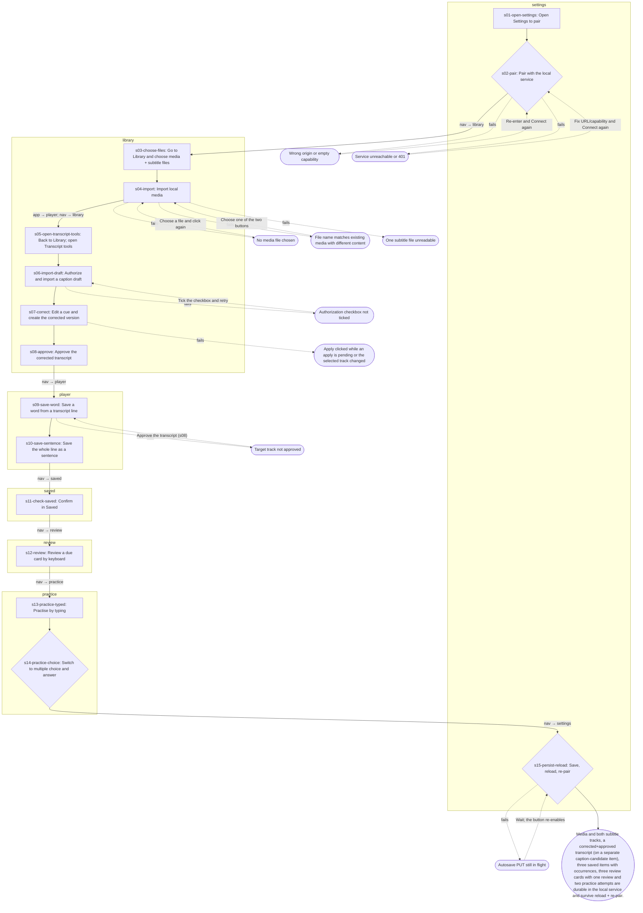

<!-- GENERATED from docs/workflows/as-is/journeys/daily-driver-learning-loop.yaml by scripts/workflows/generate-projections.cli.ts. Do not edit; edit the YAML and regenerate. -->

# Daily-driver learning loop (pair, import, draft/correct/approve, save, review, practise, persist)

**Goal (learner):** Study my own video with my own subtitles, save words and a sentence from it, review and practise them, and keep all of it in the local service.

**Evidence:** observed-live — docs/dev/lt-3kk-daily-driver-journey-plan.md (live run 4, rows sha256 948cacf9…, all 13 phases passed). Steps follow lt-3kk phases 01–07 and 09 through the UI. Per-step UX attributes the run did not record (focus, banner wording, guards) are traced to source and labelled source-reading on that step. Run 4 predates lt-uzo (cards are now created on save), so s09/s10 card creation is source-reading. Phases 08 and 10–13 are security/robustness checks, not learner steps; export/restore (phase 11) is its own journey.

**Preconditions:**
- The Docker stack is running and the browser is on the app origin with an empty local-service store.
- The learner has the service's session capability (printed by scripts/pair-local.ts).
- A local media file plus target and native .srt files exist on this computer.

## Flow

## Friction table

Totals: 15 steps · 28 clicks/pointer actions · 4 key presses · 5 typing/paste actions · 8 view switches · 3 decisions · 0 modal interruptions · 14 service calls · 9 failure branches · focus lost after 2 step(s). Evidence: observed-live 15.

| Step | View | User sees | User does | Feedback | Persists | API | Can fail | Focus after | Evidence |
| --- | --- | --- | --- | --- | --- | --- | --- | --- | --- |
| s01-open-settings Open Settings to pair | settings | Player view with the empty-video placeholder ("Import local files" / "Load synthetic fixture"); the nav bar Player · Library · Saved · Review · Practice · Export / Import · Settings. | click shell.btn | Settings renders; the "Local service / SQLite durable state" panel shows the URL (prefilled with the page origin), a masked "Session capability (private pairing)" field, Connect / Disconnect / Save state now, and an autosave checkbox. | — | — | — | — | observed-live |
| s02-pair Pair with the local service — decision: If browser work differs from durable state a three-button group appears (Keep browser work / Load service state (discard browser edits) / Cancel connection) and nothing is saved until one is chosen. | settings | Status line "Local service not connected."; autosave checkbox unchecked. | type settings.local-service-capability; click settings.connect-local-service; click settings.local-service-autosave | Status goes "Connecting and comparing durable state; browser work is kept." then "Connected to local service and loaded durable state." (role=status). The capability field is emptied. | — | GET /api/status; GET /api/state | Wrong origin or empty capability; Service unreachable or 401 | settings.connect-local-service | observed-live |
| s03-choose-files Go to Library and choose media + subtitle files | library | Library "Add media" card: "Subtitles (optional)" multi-picker first, a "Choose target and native separately" disclosure, then the "Import copy for this session only" video picker and the primary "Import local media" button. | click shell.btn; click library.separatetoggle; file-input library.local-media-file; file-input library.local-target-subtitle-file; file-input library.local-native-subtitle-file | Pickers show the chosen names; the assignment line reads "Target: … · Native: …". Nothing is imported yet. | — | — | — | — | observed-live |
| s04-import Import local media | library → player | "Import local media" primary button below the pickers; "Load synthetic fixture" secondary. | click library.import-local-media | App switches to Player; the video stage shows the file (object URL); transcript rows render from the target .srt with native lines beneath; the Library list gains a row with "Transcript ready" (own subtitles are approved on import). With autosave on a PUT follows and the sync line reports saving/saved. | media asset (fingerprint, title); two subtitle tracks (target approved, native); cues | PUT /api/state | No media file chosen; File name matches existing media with different content; One subtitle file unreadable | body | observed-live |
| s05-open-transcript-tools Back to Library; open Transcript tools | library | Player with the imported video. The correction tools live in Library inside a collapsed disclosure "Transcript tools (auto-transcribe, captions, built-in subtitles)" (collapsed because the current track is approved). | click shell.btn; click library.disclosure | The "Transcript lifecycle" panel expands: YouTube URL field, two authorization checkboxes, local-service video path field, embedded-subtitle controls and provider buttons. | — | — | — | — | observed-live |
| s06-import-draft Authorize and import a caption draft | library | Checkbox "I authorize a public caption metadata read."; button "Import gated demo caption draft" (fake in-browser provider behind the same gate as the real YouTube path). | click library.authcheckbox; click library.import-gated-demo-caption-draft | Lifecycle status "Draft transcript imported". A NEW caption-candidate media item becomes current, so the draft is not attached to the imported video (lt-3kk G1). The correction editor appears: one textarea per cue plus start/end ms inputs and Split/Merge per line. | caption-candidate media item; draft subtitle track (status draft) with cues | PUT /api/state | Authorization checkbox not ticked | — | observed-live |
| s07-correct Edit a cue and create the corrected version | library | "Transcript correction" group with cue editors; "Create corrected transcript version" (disabled while an apply is pending); "Approve transcript for study" disabled with a gate note while edits are dirty. | type library.textarea; click library.create-corrected-transcript-version | Lifecycle status "Corrected transcript version created"; a new corrected track (manual-edit, unapproved) becomes current and the editor re-keys onto it. Approve enables once no edits are dirty. | corrected subtitle track version (unapproved) with cues | PUT /api/state | Apply clicked while an apply is pending or the selected track changed | body | observed-live |
| s08-approve Approve the corrected transcript | library | "Approve transcript for study" primary button, now enabled; gate note hidden. | click library.approve-transcript-for-study | Lifecycle status "Transcript approved for study"; focus moves to the status line; the Player's draft banner disappears and Save controls become enabled. | corrected track status approved (approvedAt); original draft stays draft | PUT /api/state | — | transcript-lifecycle-status (status line) | observed-live |
| s09-save-word Save a word from a transcript line | player | Player transcript rows (role=button) with per-word buttons; each row has "Save sentence…", "Show words", "Analyse words". The capture panel reads "Select a word or phrase in a transcript line to save it with the video and time it came from." | click shell.btn; select-text player.button; type player.selection-meaning; key Enter | Video pauses when the form opens; focus goes to Meaning. On save the form closes, focus returns to the cue row, and a toast "Saved “word” · Undo" (role=status) shows for 5 s. A recognition review card is created automatically. | saved item (lexeme); saved occurrence with source context (media, track, cue, char span); review card + state (new, due now) | PUT /api/state | Target track not approved | cue row of the saved line | observed-live |
| s10-save-sentence Save the whole line as a sentence | player | "Save sentence…" button on the cue row (enabled now). | click player.save-sentence; click player.save | Capture heading "Save a sentence"; after Save a toast "Saved “…” · Undo", focus back on the row; card auto-created. | saved item (sentence); saved occurrence (whole cue span); review card + state | PUT /api/state | — | cue row of the saved line | observed-live |
| s11-check-saved Confirm in Saved | saved | Saved view with tabs "My Vocab" / "My Sentences"; each item shows kind · language · saved N times, an occurrence link "▶ time — cue", a source disclosure and a toggle "In review ✓" (aria-pressed). | click shell.btn; click saved.btn | Both tabs list the items; toggles read "In review ✓" because cards were created on save. "Add all to review (N)" appears only when an item lacks a card. | — | — | — | — | observed-live |
| s12-review Review a due card by keyboard | review | Review view: prompt "Recognize: word" (role=alert); "Show answer / context" (aria-keyshortcuts Space) and "Replay source line"; hint "Space: show answer · 1–4: rate (Again, Hard, Good, Easy) · ?: all shortcuts". | click shell.btn; key Space; key 3 | Reveal shows the target text, meaning (or an inline "Add meaning" when there is neither meaning nor native line), the source time range and cue text; four rating buttons appear. Rating loads the next due card or the empty state "No cards due right now…"; focus goes to the reveal toggle / empty state. | review event; review-card state (FSRS reps 1, state learning) | PUT /api/state | — | review.hide-answer | observed-live |
| s13-practice-typed Practise by typing | practice | Practice view: prompt (role=alert), "Mode" select (Typed input / Multiple choice / Sentence builder / Audio recall / Speaking), "Your answer" field, Replay source line · Skip · Submit attempt; "Reveal answer" below. | click shell.btn; type practice.practice-answer-2; click practice.submit-attempt | Feedback banner (role=status, tabindex -1) "Previous card — Result: pass ✓"; the next due card loads; focus moves to the banner. | practice attempt (typed-input, pass); FSRS state update + review event | PUT /api/state | — | practice-feedback (status banner) | observed-live |
| s14-practice-choice Switch to multiple choice and answer — decision: Which practice mode to use (5 modes; Speaking shows "Speaking is not available. No microphone is requested or used."). | practice | Mode select; after switching, a "Multiple choice answers" group of buttons. | key ArrowDown; click practice.choicebtn | Feedback banner "Previous card — Result: fail. Expected: …"; focus to the banner. | practice attempt (multiple-choice, fail); FSRS state update | PUT /api/state | — | practice-feedback (status banner) | observed-live |
| s15-persist-reload Save, reload, re-pair — decision: On reconnect with differing browser work the Keep browser work / Load service state / Cancel group appears. | settings | Settings; "Save state now" (disabled while a save is in flight). After reload the app boots from the browser snapshot cache and the service is "not connected" until paired again. | click shell.btn; click settings.save-state-now; navigate; type settings.local-service-capability; click settings.connect-local-service | "Connected to local service and loaded durable state."; Saved lists the same items; review/practice history intact. | — | PUT /api/state; GET /api/status; GET /api/state | Autosave PUT still in flight | — | observed-live |

## Variants not walked

- **persistent-picker** (diverges at s03-choose-files): In Chrome the primary action is "Choose video (recommended — stays linked after reload)" (File System Access picker, handle persisted per media). The session-only file input walked here is the fallback the harness can drive. _[source-reading]_
- **own-subtitles-skip-correction** (diverges at s05-open-transcript-tools): Subtitle files imported with the media are trusted and already approved (lt-3kk F1), so a learner who only uses their own .srt goes straight from s04 to s09. The draft/correct/approve steps apply only to provider or ASR drafts. _[source-reading]_
- **multi-select-subtitles** (diverges at s03-choose-files): One multi-file picker assigns target/native by filename and offers Swap; the separate per-role inputs walked here sit inside the "Choose target and native separately" disclosure. _[source-reading]_

## Outcome

Media and both subtitle tracks, a corrected+approved transcript (on a separate caption-candidate item), three saved items with occurrences, three review cards with one review and two practice attempts are durable in the local service and survive reload + re-pair.

Persisted: media assets ×2; subtitle tracks ×4; cues; saved items ×3; saved occurrences ×3; review cards ×3 with states; review events; practice attempts ×2

## Observations (neutral, as-is)

- **o1-draft-not-on-imported-video** (at s06-import-draft): The only offline way to get a draft (demo caption) creates a separate media item, so correcting and approving never happens on the learner's own imported video in this journey (lt-3kk G1). Own .srt files are approved on import (F1), so the correction tools are unreachable for them. _[observed-live: lt-3kk run 4 G1/F1]_
- **o2-tools-live-in-library** (at s05-open-transcript-tools): Transcript correction/approval is in Library (inside a disclosure) while saving words happens in Player; the draft→approve→save loop needs two nav round-trips (s05, s09). _[source-reading: apps/web/src/views/library.ts:1012]_
- **o3-focus-lost-after-import-and-apply** (at s07-correct): Import local media (s04) and Create corrected transcript version (s07) re-render without a focus successor, so keyboard focus lands on body; Approve, Rate, Submit and choice buttons do have successors (lt-r4k.2). _[observed-live: lt-3kk run 4 observation: focus after Apply lands on body (lt-5lb.1)]_
- **o4-cards-auto-created** (at s09-save-word): Saving creates the review card automatically (idempotent per item) and Saved shows an "In review ✓" toggle; the lt-3kk plan text about an explicit "Create review card" predates lt-uzo. _[source-reading: apps/web/src/model.ts:3212]_
- **o5-pairing-every-session** (at s15-persist-reload): The capability is cleared after Connect and must be re-entered after every reload and every service restart unless "Remember pairing" is opted in. _[source-reading: apps/web/src/views/settings.ts:217]_
- **o6-two-answer-fields** (at s13-practice-typed): Two different "practice-answer" inputs exist in source (audio-recall branch and typed branch); only one renders at a time, so the pass-1 ids are practice.practice-answer and practice.practice-answer-2. _[source-reading: apps/web/src/views/practice.ts:218]_
