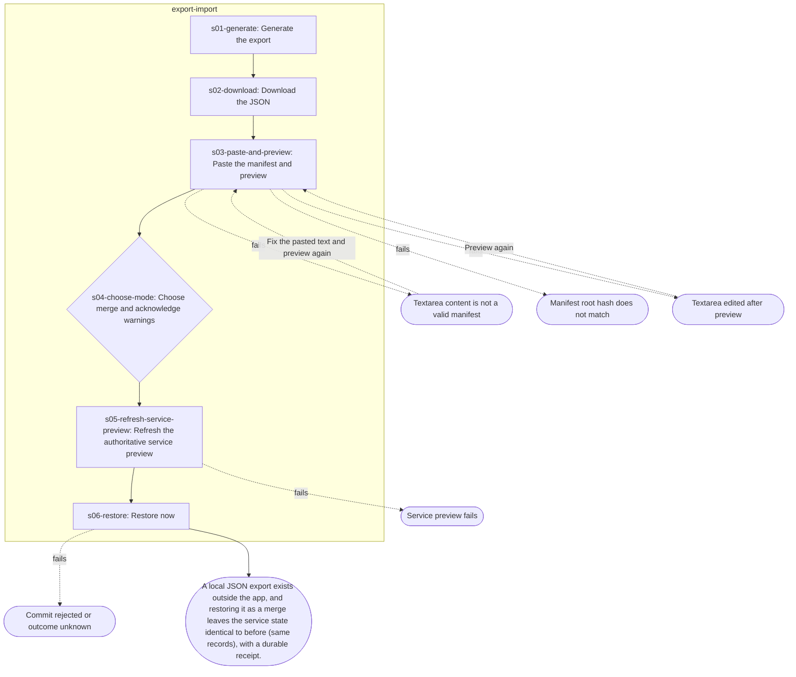

<!-- GENERATED from docs/workflows/as-is/journeys/export-restore-learner-state.yaml by scripts/workflows/generate-projections.cli.ts. Do not edit; edit the YAML and regenerate. -->

# Export learner state and restore it (merge) through the local service

**Goal (learner):** Make a local JSON copy of my saved words, cards and history, and bring such a copy back into the app.

**Evidence:** observed-live — docs/dev/lt-3kk-daily-driver-journey-plan.md (live run 4, journey-11 PASS; durable receipt, commit 200, readback). The run captured the download in page memory and pasted it back; a real learner downloads a file and pastes its text. Button and banner texts are traced to apps/web/src/views/exportImport.ts.

**Preconditions:**
- Paired with the local service (daily-driver s02) and some learner state exists.

## Flow

## Friction table

Totals: 6 steps · 8 clicks/pointer actions · 0 key presses · 1 typing/paste actions · 0 view switches · 1 decisions · 0 modal interruptions · 3 service calls · 5 failure branches · focus lost after 0 step(s). Evidence: observed-live 6.

| Step | View | User sees | User does | Feedback | Persists | API | Can fail | Focus after | Evidence |
| --- | --- | --- | --- | --- | --- | --- | --- | --- | --- |
| s01-generate Generate the export | export-import | Export / Import view; a long intro paragraph on what the learner-subset export includes/excludes; "Export learner state" with the primary "Generate local export". | click shell.btn; click export-import.generate-local-export | Success banner (role=status) "Learner-state export v1 ready: <file> • N records • N privacy warnings • manifest integrity verified … • no media files copied"; a Schema / App version / Exported at / root hash list; then "Download export JSON" (and "Save export to chosen file" when supported). | — | — | — | — | observed-live |
| s02-download Download the JSON | export-import | "Download export JSON" secondary button; a note that browser downloads are not read back. | click export-import.download-export-json | Browser download of the manifest JSON (object URL + anchor click); no in-app confirmation beyond the existing banner. | — | — | — | — | observed-live |
| s03-paste-and-preview Paste the manifest and preview | export-import | "Import / restore learner state" group: label "Paste export manifest JSON", a textarea, "Preview restore". | paste export-import.import-manifest; click export-import.preview-restore | "Restore preview" region: Schema / App version / Exported at / record count / root hash; a "Metadata-only restore preview" note; per-collection counts; an operation preview; a safety banner ("Safe to restore: local learner state is empty." or "Local learner state exists. Resolve the conflict below before restoring."); an integrity banner. | — | — | Textarea content is not a valid manifest; Manifest root hash does not match; Textarea edited after preview | — | observed-live |
| s04-choose-mode Choose merge and acknowledge warnings — decision: Merge/update vs Replace active learner data (mutually exclusive checkboxes); when local state is empty a single "I confirm this restore." checkbox replaces them. | export-import | "Resolve restore conflict" with two checkboxes (Merge/update … / Replace active learner data …) and an error line "Restore requires one of the options above to be selected."; a "Privacy warnings" list with one checkbox per warning kind. | click export-import.restore-confirm-overwrite; click export-import.checkbox | Checking one mode unchecks the other; the error line hides; "Restore now" stays disabled until all warnings are acknowledged and, when connected, until the authoritative preview is refreshed. | — | — | — | — | observed-live |
| s05-refresh-service-preview Refresh the authoritative service preview | export-import | "Refresh authoritative service preview" button next to "Restore now" (connected only). | click export-import.refresh | The service-side preview replaces the local one; "Restore now" becomes enabled. | — | POST /api/restore/preview | Service preview fails | — | observed-live |
| s06-restore Restore now | export-import | "Restore now" primary button enabled. | click export-import.restore-now | Button disables while committing; on success the view re-renders with the restore result and no role=alert banner; Saved/Review show the merged set. | restored learner subset merged into the service store (saved items, occurrences, cards, states, events, attempts); new state revision | POST /api/restore/commit; GET /api/state | Commit rejected or outcome unknown | — | observed-live |

## Variants not walked

- **save-to-chosen-file** (diverges at s02-download): With File System Access a second button "Save export to chosen file" writes through a save picker and confirms by readback ("Verified: … saved and readback matched …"). _[source-reading]_
- **browser-only-restore** (diverges at s05-refresh-service-preview): When no service is connected, "Restore now" enables straight after the local preview and restores into the browser store only. _[source-reading]_
- **replace-mode** (diverges at s04-choose-mode): "Replace active learner data" removes active records absent from the file (prior history kept as inactive audit). _[source-reading]_
- **anki-export** (diverges at s01-generate): The same view offers Anki exports (.apkg via the service, .txt in the browser); not part of restore. _[source-reading]_

## Outcome

A local JSON export exists outside the app, and restoring it as a merge leaves the service state identical to before (same records), with a durable receipt.

Persisted: learner subset merge (no-op when identical); service revision

## Observations (neutral, as-is)

- **o1-paste-only-import** (at s03-paste-and-preview): Import is paste-into-textarea only; there is no file picker for the exported JSON, while export has both a download and a save-picker path. _[source-reading: apps/web/src/views/exportImport.ts:151]_
- **o2-three-confirmations** (at s04-choose-mode): A connected merge needs the mode checkbox, every warning checkbox and an explicit service preview refresh before Restore enables (three distinct confirmation gestures plus the preview click). _[source-reading: apps/web/src/views/exportImport.ts:351]_
- **o3-dense-copy** (at s01-generate): The view opens with a long intro paragraph, and the preview adds further explanatory paragraphs before any control. _[source-reading: apps/web/src/views/exportImport.ts:31]_
